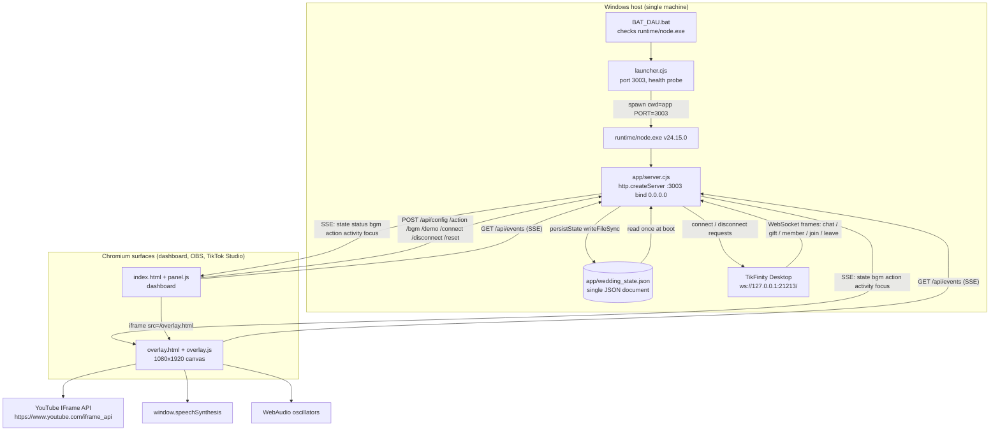

# 02 — TECHNOLOGY STACK AND SYSTEM ARCHITECTURE

## 2.1 Verified stack

| Layer | Technology | Evidence |
|---|---|---|
| Runtime | Bundled **Node.js v24.15.0** (`runtime/node.exe`, 91.7 MB) | ran `runtime/node.exe --version` → `v24.15.0` |
| Backend language | CommonJS JavaScript (`.cjs`), `require('node:http')` style | `server.cjs:1-5`, `launcher.cjs:1-3` |
| Backend framework | **none** — raw `node:http.createServer` | `server.cjs:620` |
| Templating / SSR | none; static files only | `server.cjs:874-895` |
| Frontend framework | **none** — vanilla DOM + ES module (`overlay.js` is `type="module"`) | `overlay.html:216`, `index.html:459` |
| Frontend styling | hand-written CSS, CSS keyframe animations, Web Animations API (`element.animate`) | `overlay.css` (all effects), `overlay.js:700-712` |
| Realtime server→browser | **Server-Sent Events** (`text/event-stream`) | `server.cjs:646-658`, `overlay.js:10-15`, `panel.js:320` |
| Realtime browser→server | `fetch()` POST JSON | `panel.js:50-60`, `:120`, `:211` |
| TikTok integration | **outbound WebSocket client** to TikFinity Desktop | `server.cjs:407` (`new WebSocket(this.endpoint)`), endpoint `ws://127.0.0.1:21213/` |
| Fallback TikTok integration | HTTP webhook receiver | `server.cjs:798-827` |
| Persistence | single JSON file, synchronous full-file rewrite | `server.cjs:8`, `:150-156` |
| Audio (SFX) | WebAudio oscillator synthesis | `overlay.js:123-188` (`playClink`, `playWeddingBell`, `playFanfare`) |
| Audio (voice) | Web Speech API `speechSynthesis` | `overlay.js:191-207` |
| Audio (music) | YouTube IFrame Player API (remote script) | `overlay.html:13`, `overlay.js:47-85` |
| Dev tooling (not shipped in flow) | headless Edge + raw CDP WebSocket | `capture_verify.cjs` |
| Packaging | `.bat` + `launcher.cjs` + portable node + folder copy | `BAT_DAU.bat`, `launcher.cjs` |
| Build system | **none** (no package.json, no lockfile, no `node_modules`) | `ls package.json` → not present |
| Database | **none** | no SQLite/driver reference anywhere |
| Process IPC | none used; child inherits stdio (`stdio: 'inherit'`) | `launcher.cjs:39-49` |

### Dependency note

`WebSocket` is used as a **global** at `server.cjs:406` with no import and no polyfill. This is only available on Node ≥ 21/22; the bundled `runtime/node.exe` is v24.15.0, so it works — but the coupling is implicit (no `package.json#engines`, no version assertion at boot).

---

## 2.2 Runtime topology

Three independent browser surfaces and one daemon:

1. **Server** — `app/server.cjs`, listens on `0.0.0.0:3003` (env `PORT`, `server.cjs:7`, `:897`).
2. **Dashboard** — `http://localhost:3003/` → `index.html` + `panel.js` + `panel.css`.
3. **LIVE overlay** — `http://localhost:3003/overlay.html` → `overlay.html` + `overlay.js` + `overlay.css`; loaded standalone in OBS/TikTok Studio **and** inside the dashboard's 9:16 preview iframe (`index.html:452`).
4. **TikFinity Desktop** — an external, separately installed Windows app owned by the user; the server is only a client of it.

The server has **no knowledge of which browsers are open**. `clients` is an anonymous `Set` of SSE response objects (`server.cjs:159`).

---

## 2.3 Architecture diagram (verified)



---

## 2.4 Communication contracts

### A. HTTP (dashboard → server)

Plain `fetch` with JSON bodies, no auth header, no CSRF token. Every response carries permissive CORS headers set once at the top of the request handler (`server.cjs:621-625`). Responses are JSON except `/api/events` (SSE), `/api/speech` (audio/mpeg passthrough) and static files.

### B. SSE (server → all browsers)

`broadcast(event, data)` (`server.cjs:160-170`) serialises `data` and writes:

```
event: <name>\ndata: <JSON>\n\n
```

to every response in `clients`. A browser that connects late first receives one `state` and one `status` snapshot (`server.cjs:651-652`), then only deltas. **No replay of ceremonies or the offering queue.**

### C. WebSocket (server → TikFinity)

One outbound socket, created per connect attempt, never multiplexed. The endpoint is a hard-coded literal in two places (`server.cjs:407` default parameter, `server.cjs:568` explicit argument) — it is **not** configurable through the dashboard or the state file.

### D. Shared state

There is **no shared state between browser and server** other than the SSE stream and the JSON file. The overlay keeps a local `currentState` (`overlay.js:209`) refreshed by `event: state`, used only for config lookups (wishes, speech settings, BGM, particle toggles).

### E. Process control

`launcher.cjs` spawns the server with `stdio: 'inherit'` and forwards `SIGINT` to the child (`launcher.cjs:56`). There is no IPC channel, no socket handshake, no PID file.

---

## 2.5 Where the architecture is intentionally minimal

| Concern | Actual implementation |
|---|---|
| Routing | linear `if (pathname === ...)` chain, 13 branches, then a static fallback |
| Validation | ad-hoc `Number()`/`String()` coercions plus `Math.max(1, …)` floors |
| Error middleware | none; each route writes its own status |
| Auth | none on any route |
| Schema/migration | none; state merged over `defaultState` with manual per-key merges (`server.cjs:128-148`) |
| Concurrency | Node event loop only; no locks, no per-event queue server-side |
| Observability | `console.log` of the listen banner and persistence errors only |
