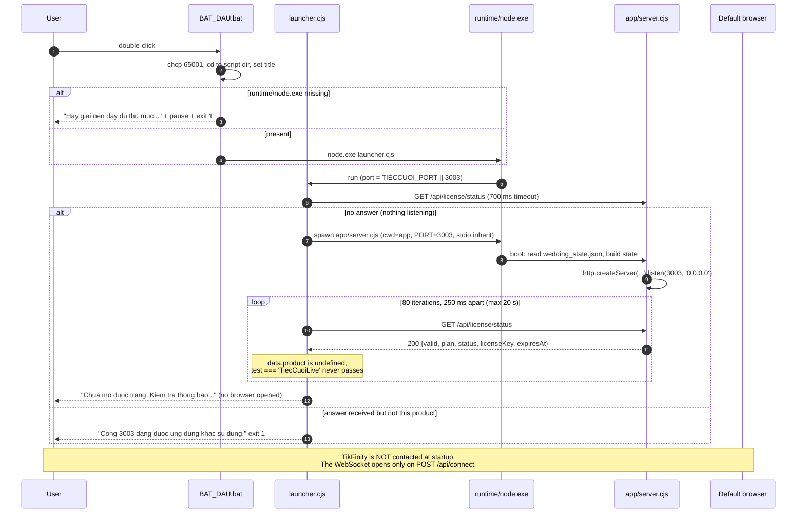

# 03 — APPLICATION STARTUP FLOW

## 3.1 Sequence as implemented

## 3.2 Step-by-step, with code references

| # | Step | Code | Notes |
|---|---|---|---|
| 1 | Console encoding + working directory | `BAT_DAU.bat:2-3` | `chcp 65001` is required for the Vietnamese console banner |
| 2 | Runtime presence gate | `BAT_DAU.bat:5-8` | Only checks `runtime\node.exe` exists |
| 3 | Run supervisor | `BAT_DAU.bat:9` | `"%~dp0runtime\node.exe" "%~dp0launcher.cjs"` |
| 4 | Resolve port | `launcher.cjs:6` | `process.env.TIECCUOI_PORT` overrides the 3003 default |
| 5 | Single-instance probe | `launcher.cjs:16-23`, `:26` | 700 ms HTTP probe of the licence endpoint — used purely as a liveness signal |
| 6 | Identity check (broken) | `launcher.cjs:27`, `:59` | compares `data.product` with `'TiecCuoiLive'`; the endpoint never returns `product` |
| 7 | Port-conflict branch | `launcher.cjs:32-36` | any reachable-but-unmatched listener is treated as a foreign app |
| 8 | Spawn server | `launcher.cjs:39-49` | `cwd = app`, `env.PORT`, stdout/stderr inherited so server logs appear in the same console |
| 9 | Child error handling | `launcher.cjs:50-54` | spawn error message; child exit propagated as launcher exit code |
| 10 | Ctrl+C forwarding | `launcher.cjs:56` | `child.kill()` |
| 11 | Boot: load state | `server.cjs:128-148` | `existsSync` → `readFileSync` → `JSON.parse`; deep-ish merge over `defaultState`; on failure logs and keeps defaults |
| 12 | Bind | `server.cjs:897` | `server.listen(PORT, '0.0.0.0')`, logs the URL |
| 13 | Dashboard load | `GET /` → `server.cjs:874-895` | serves `public/index.html` with `no-cache` |
| 14 | Dashboard stream | `panel.js:320` | `new EventSource('/api/events')`; server immediately writes `state` + `status` (`server.cjs:651-652`) |
| 15 | Overlay load (OBS / iframe) | `overlay.html` + `overlay.js` | `fit()` scales the fixed 1080×1920 frame; second `EventSource` opened at `overlay.js:756` |
| 16 | TikFinity connection | on demand | `POST /api/connect` → `connectTikFinity()` (`server.cjs:554`) → `ws://127.0.0.1:21213/` |
| 17 | Persistence | on every mutation | `persistState()` (`server.cjs:150`) rewrites the whole JSON document synchronously |

## 3.3 Environment variables

| Variable | Read by | Effect |
|---|---|---|
| `TIECCUOI_PORT` | `launcher.cjs:6` | Launch port; the spawned server receives it as `PORT` |
| `PORT` | `server.cjs:7` | Server listen port (default 3003) |
| `SystemRoot` | `launcher.cjs:10` | Locates `System32\rundll32.exe` for opening the browser |
| `PATH` etc. | inherited | passed through to the child (`env: {...process.env, PORT}`) |

No `.env` file, no dotenv loading, no config file other than `wedding_state.json`.

## 3.4 Licence verification at startup

**There is none.** `GET /api/license/status` (`server.cjs:660-670`) unconditionally returns a hard-coded success object (`valid: true`, `plan: 'pro'`, `status: 'active'`, a literal licence-key string, `expiresAt: '2099-12-31'`). The launcher's only use of it is as a ping. Nothing in `server.cjs`, `launcher.cjs` or the front end compares, decodes or enforces a licence. No network call is made to any licence server (the only outbound calls in the codebase are the TikFinity WebSocket, the YouTube IFrame script, and the Google TTS fetch in `/api/speech`).

## 3.5 Startup failure points (observed in code, not exercised)

| # | Failure | Mechanism | User-visible result |
|---|---|---|---|
| F1 | `runtime/node.exe` absent | `BAT_DAU.bat:5` | Bat prints extraction instructions and exits |
| F2 | Port 3003 held by an unrelated program | `launcher.cjs:32-36` | "port used by another application", exit code 1 |
| F3 | **Port 3003 already held by this app** | probe succeeds but identity test fails (`:27`) | **Misreported as F2**; browser not re-opened |
| F4 | **Clean start** | identity test also fails on the first poll (`:59`) | Server runs, but the browser is **never** opened and a failure line is printed after 20 s |
| F5 | `app/server.cjs` missing/moved | spawn succeeds, node exits non-zero | `child.on('exit')` propagates the code (`:54`) |
| F6 | Port becomes busy between probe and bind | `server.listen` emit `'error'`; **no `server.on('error')` handler exists** | Uncaught `EADDRINUSE` → server process dies immediately |
| F7 | `wedding_state.json` corrupt | `server.cjs:145-147` catch | Logs `Error loading wedding state, using default` and continues with defaults — **the corrupt file is then overwritten on the first mutation**, destroying the previous session |
| F8 | Graphically locked-down host | `rundll32 url.dll,FileProtocolHandler` may be blocked by policy | URL never opens; server still healthy |

F3, F4 and F6 are functional defects, not environmental ones; they are recorded again in `12_SECURITY_STABILITY_AUDIT.md` (F-01, F-06).
