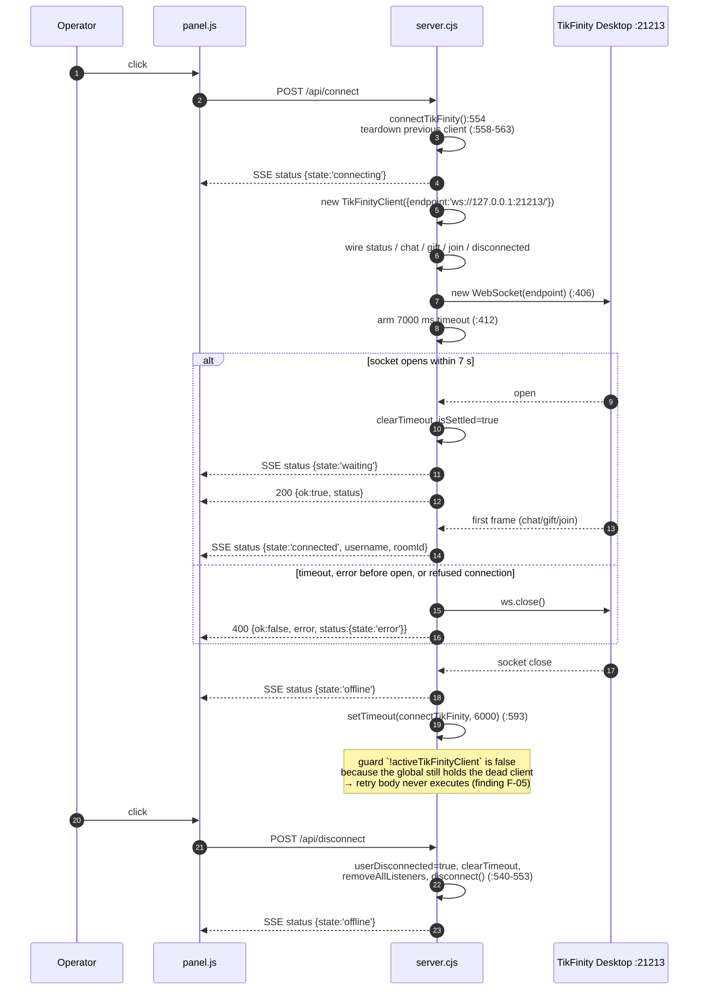
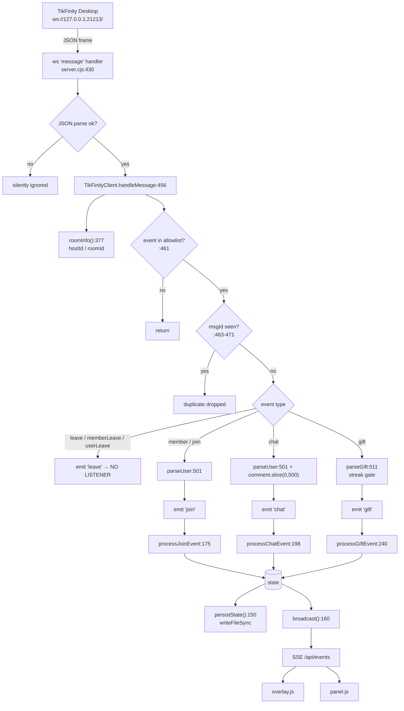

# 04 — TIKFINITY INTEGRATION

> **Priority subsystem.** Everything below was read from `app/server.cjs`. Runtime payload shapes produced by TikFinity Desktop itself could not be observed (no TikFinity process was started during this analysis) — those points are marked **INFERRED** or **UNKNOWN**.

## 4.1 Connection architecture

| Question | Verified answer | Evidence |
|---|---|---|
| Mechanism | **WebSocket** (client role) | `new WebSocket(this.endpoint)` `server.cjs:406` |
| Endpoint | `ws://127.0.0.1:21213/` — **hard-coded twice** | `server.cjs:358` (default param), `server.cjs:568` (explicit) |
| Who initiates | **The backend**, not the browser | `connectTikFinity()` `server.cjs:554-603` |
| Who can trigger it | Dashboard button → `POST /api/connect`, or the webhook path is independent | `panel.js:386-405`, `server.cjs:768-781` |
| Configurability | **None** — no state key, no UI field, no env var for host/port | full-file read of `server.cjs`, `index.html`, `panel.js` |
| Subscription mechanism | **None** — the server connects and passively parses whatever frames arrive; no subscribe message is sent | `connect()` `server.cjs:391-454` sends nothing after `open` |
| Concurrency | Exactly **one** active client at a time (`activeTikFinityClient`) | `server.cjs:536`, `:558-563` |
| Transport options in Node | relies on the **global** `WebSocket` (Node ≥ 21/22). Bundled runtime is v24.15.0, so available; no import or polyfill exists | `server.cjs:406`; `runtime/node.exe --version` → v24.15.0 |

### Client class

`class TikFinityClient extends EventEmitter` — `server.cjs:357-534`

| Member | Lines | Behaviour |
|---|---|---|
| `constructor({endpoint})` | 358-366 | stores endpoint, `closed=false`, `socket=null`, `seen=new Set()`, `roomId=''`, `hostId=''` |
| `status(stateName, message)` | 368-375 | builds a human message from known `hostId`/`roomId`, emits `'status'` with `{state, message, username, roomId, mode:'tikfinity'}` |
| `roomInfo(e)` | 377-389 | opportunistically mines the room owner's `uniqueId` (validated `/^[\w.]{2,64}$/`) and numeric room id (`/^\d{5,30}$/`) from `data.roomInfo`/`data.room`/`data.host`/`data.common` |
| `connect()` | 391-454 | see state machine below |
| `handleMessage(msg)` | 456-499 | allowlist → dedup → per-type parsing → emit |
| `parseUser(t)` | 501-509 | id/name/avatar extraction with fallbacks |
| `parseGift(t)` | 511-524 | gift name/id/count/diamond extraction + streak gate |
| `disconnect()` | 526-533 | `closed=true`, close socket if `readyState < 2` |

### `connect()` state machine (`server.cjs:391-454`)

- Creates the socket inside `try/catch`; a synchronous throw rejects immediately (`:404-409`).
- Arms a **7 000 ms** timeout (`:412-415`); on expiry it rejects and closes the socket.
- `open` → clears timer, sets `connected`, **resolves the promise**, emits `status('waiting', 'Đã kết nối TikFinity! Đang chờ bình luận/quà…')` (`:417-428`).
- `message` → decodes string / Blob (`data.text()`) / Buffer, `JSON.parse`, then `handleMessage`; the whole block is wrapped in `try {} catch {}` so malformed frames are **silently dropped** (`:430-437`).
- `error` → rejects only if the socket never opened (`:439-441`).
- `close` → if it had been connected, emits `'disconnected'`; otherwise rejects the pending promise (`:443-453`).

Promise settlement is guarded by `isSettled`, so a late `error` after `open` cannot double-settle.

## 4.2 Event reception

`handleMessage` (`server.cjs:456-499`) accepts exactly this allowlist (`:461`):

```js
['chat', 'gift', 'member', 'join', 'leave', 'memberLeave', 'userLeave']
```

Everything else returns immediately. **Gift / like / comment / follow / share / subscribe / join support matrix:**

| TikTok event | Supported? | Evidence |
|---|---|---|
| **Gift** | **Yes** | `server.cjs:493-498` → `parseGift` → `emit('gift')` → `processGiftEvent` |
| **Comment / chat** | **Yes** (truncated to 500 chars) | `server.cjs:486-492` → `emit('chat')` → `processChatEvent` |
| **Join / member** | **Yes** | `server.cjs:478-485` → `emit('join')` → `processJoinEvent` |
| **Leave** (`leave`/`memberLeave`/`userLeave`) | **Received, parsed, emitted — but nobody listens** | emit at `:475`; `connectTikFinity` registers only `status`,`chat`,`gift`,`join`,`disconnected` (`:571-595`). No handler → viewers are never removed |
| **Like** | **No** | the string `like` does not occur in `server.cjs` (case-insensitive grep: no match) |
| **Follow** | **No** | no `follow` occurrence |
| **Share** | **No** | no `share` occurrence |
| **Subscribe / Superfan / Treasure / RoomUserSeq** | **No** | no occurrence of `subscri`, `superfan`, `treasure` |

### Per-event data contract

| Event | Incoming (from TikFinity frame `data`) | Receiver | Handler | State effect | Emitted SSE |
|---|---|---|---|---|---|
| `chat` | `user.*` (via `parseUser`), `comment` \|\| `content` (≤500) | `handleMessage:486` | `processChatEvent` `:198` | guest created if new; `stats.wishes++`; keyword may select an action | `activity{type:'chat',id,name,comment,avatar,triggeredAction}`, maybe `action`, `state` |
| `gift` | `user.*`, `giftDetails.giftName \|\| gift.name \|\| extendedGiftInfo.name \|\| giftName`, `giftId`, `repeatCount\|\|count`, `diamondCount \|\| diamond_count \|\| diamonds` | `handleMessage:493` | `processGiftEvent` `:240` | `stats.envelopes+=count`; goals; `scores[id].total += count*diamonds`; registry; guest created/upgraded; **possible groom replacement** | `focus{...}`, maybe `action`, `state` |
| `join` / `member` | `user.*` | `handleMessage:478` | `processJoinEvent` `:175` | guest created if new; `stats.guests++` | `activity{type:'join'}`, `state` |
| `leave` family | `user.*` | `handleMessage:473` | **none** | none | none |

Dedup rule (`server.cjs:463-471`): key = `eventName + '|' + (data.msgId || data.common.msgId)`; only applied when the id is truthy and not `'0'`. The `Set` is FIFO-capped at 5 000 entries. Room-info mining runs before the allowlist check (`:460`), so room identity can be learned from frames of any type.

### `parseUser` fallbacks (`server.cjs:501-509`)

`id` ← `userId` → `idStr` → `id` → `uniqueId` → `displayId` → `'unknown'`
`name` ← `nickname` → `uniqueId` → `displayId` → `'Khách Mời'` (truncated to 60)
`avatar` ← first of `profilePicture.urls` → `profilePicture.urlList` → `avatarThumb.urlList` → `avatarLarge.urlList`, else `profilePictureUrl`

Every processor early-returns when `id` is `'unknown'` (`:176`, `:199`, `:241`), so unresolvable users are dropped rather than corrupting state.

### `parseGift` streak gate (`server.cjs:511-524`)

```js
if (Number(e.giftType ?? e.type ?? t.giftType) === 1 && !t.repeatEnd) return null;
```

Reading: for a **streakable** gift (`giftType === 1`) the event is discarded until a frame arrives with `repeatEnd` truthy; the final frame's `repeatCount` is used as `count`. Non-streak gifts (`giftType !== 1`) pass immediately. Consequence: **mid-streak frames do not update the UI at all** — no incremental combo counter, by design or otherwise. If TikFinity's frame omits `repeatEnd`, streakable gifts are dropped entirely (**UNKNOWN** whether it always sends it).

### Connection sequence (verified, including the dead retry)



## 4.3 Event processing path (verified)

```
TikFinity Desktop
  → ws frame (JSON text)
  → ws 'message' listener                      server.cjs:430
  → JSON.parse (silent catch)                  server.cjs:433
  → TikFinityClient.handleMessage              server.cjs:456
  → allowlist                                   server.cjs:461
  → dedup by msgId                              server.cjs:463-471
  → roomInfo (any type)                         server.cjs:460 / :377
  → parseUser / parseGift                       server.cjs:501 / :511
  → EventEmitter.emit('chat'|'gift'|'join')     server.cjs:485/492/497
  → connectTikFinity listener                   server.cjs:573-587
  → processChatEvent / processGiftEvent / processJoinEvent
  → mutate `state`                              :204-236 / :247-283 / :182-195
  → persistState()                              :156
  → broadcast('activity'|'focus'|'action'|'state')   :160
  → SSE → overlay.js / panel.js
```



## 4.4 Normalisation, validation, logging

| Concern | Implementation |
|---|---|
| Parsing | `JSON.parse` inside `try{}catch{}` — a bad frame is invisible (`server.cjs:431-436`) |
| Normalisation | `parseUser` / `parseGift` only; no shared schema, no zod/joi, no runtime type guards |
| Validation | `Math.max(1, Number(x) || 1)` floors for `count`/`diamonds` (`:244-245`); comment `slice(0,500)` (`:488`); name `slice(0,60)` (`:506`); `'unknown'` sentinel rejection |
| Logging | **none per event** — no `console.*` in any processor or in `handleMessage`; only the boot banner and persistence errors are logged (`:153`, `:897`) |
| Metrics / counters | only the user-facing `state.stats` / `state.scores` aggregates |

## 4.5 Connection reliability

| Aspect | Implemented? | Detail |
|---|---|---|
| Connect timeout | **Yes** | 7 000 ms (`server.cjs:412`) |
| Auto-reconnect | **Coded but unreachable** | `'disconnected'` schedules `connectTikFinity()` after 6 000 ms (`:591-597`), but the guard is `if (!userDisconnected && !activeTikFinityClient)`. `activeTikFinityClient` is only nulled by `disconnectTikFinity()` (`:546`) and at the start of a new `connectTikFinity()` (`:560`) — never on socket close. Since it still holds the dead client, the retry is skipped **every time**. Net effect: **no automatic recovery** |
| Heartbeat / ping-pong | **No** | no `ping`, `pong`, or interval on the socket |
| Stale-socket detection | **No** | a half-open TCP connection produces no `close`, so status stays `connected` while events stop |
| Duplicate prevention | **Yes, partial** | msgId dedup, only for frames that carry a non-`'0'` msgId |
| Reconnect state recovery | **No** | no replay/backfill; MISSING events during downtime are lost |
| Retry limits / backoff | **No** | fixed 6 s, single attempt per disconnect event |
| Status vocabulary | `offline`, `connecting`, `waiting`, `connected`, `error` | emitted at `:369`, `:548`, `:566`, `:427`, `:774`. `panel.js:340` also styles a `retry` state that **the server never emits** |
| Manual recovery | **Yes** | `POST /api/disconnect` then `POST /api/connect`; `connectTikFinity` tears down the previous client first (`:558-563`) |
| Event-loss scenarios | (a) before `/api/connect`; (b) while the socket is dead but not closed; (c) streak frames before `repeatEnd`; (d) frames suppressed by dedup; (e) malformed JSON; (f) any event type outside the allowlist | — |

## 4.6 Fallback path: webhook

`POST /api/tikfinity` (`server.cjs:798-827`) accepts a flat JSON object and re-routes it into the same three processors:

| Condition | Maps to |
|---|---|
| `event === 'chat'` **or** any body with `comment` | `processChatEvent({id: uniqueId\|userId\|name, name: nickname\|uniqueId, comment: comment\|text, avatar})` |
| `event === 'gift'` **or** body with `giftId`/`giftName` | `processGiftEvent({…, gift: giftName\|gift, count: repeatCount\|count, diamonds: diamondCount\|diamonds})` |
| `event === 'member'` / `'join'` | `processJoinEvent({…})` |
| anything else | **200 `{ok:true}` with no effect** — silently swallowed |

The URL is surfaced in the UI as `http://localhost:3003/api/tikfinity` (`index.html:411`, copy handler `panel.js:36`). It is unauthenticated and CORS-open like every other route.
