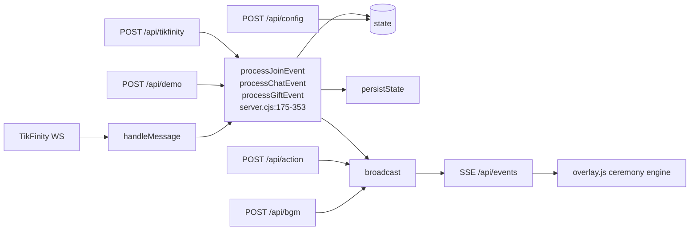

# 05 — EVENT PROCESSING ENGINE

## 5.1 Where events enter (4 independent doors, 3 shared processors)

| Door | Route / mechanism | Entry function | Processors reached |
|---|---|---|---|
| TikFinity WebSocket | `ws://127.0.0.1:21213/` | `TikFinityClient.handleMessage` `server.cjs:456` | chat / gift / join |
| Webhook | `POST /api/tikfinity` `server.cjs:798` | inline mapping in the route | chat / gift / join |
| Demo simulator | `POST /api/demo` `server.cjs:733` | inline mapping (`type:'chat'` \| `type:'gift'`) | chat / gift |
| Dashboard manual action | `POST /api/action` `server.cjs:695` | **no processor** — `broadcast('action', data)` only | overlay ceremony directly |

The three processors are commented as *"CORE EVENT PROCESSORS (Dùng chung cho TikFinity, Webhook, Demo)"* (`server.cjs:172-174`) and are the only place where viewer activity mutates state.

## 5.2 Normalisation

There is **one** normalisation layer, inside the TikFinity client (`parseUser`, `parseGift`). The webhook and demo doors must supply an already-flat object; they normalise nothing:

- webhook: `server.cjs:800-825` reads flat keys (`uniqueId`, `nickname`, `giftName`, `repeatCount`, …).
- demo: `server.cjs:735-763` builds the object from the request body and defaults (`'Khách Mời'`, `'Đại Gia Giấu Tên'`, `'Mừng Phong Bì'`).

Consequence: the same viewer can appear as two different people depending on the door (`tik-<id>` prefix is applied inside the processors, so ids are at least namespaced consistently — `:177`, `:200`, `:242`).

## 5.3 Handler selection and priority

| Mechanism | Verified answer |
|---|---|
| Selection | String compare on the TikFinity `event` field (`:461`) followed by `EventEmitter.emit('<type>')`; listeners registered once in `connectTikFinity` (`:571-595`) |
| Priority | **None.** No priority field, no severity ranking, no ordering guarantee |
| Pre-emption | None server-side; the dashboard's `/api/action` can *visually* pre-empt a running ceremony on the overlay because the overlay just reacts to each `action` immediately |
| Fan-out | One TikTok event can produce **2-3** SSE events: `activity`/`focus` + optional `action` + `state` |

## 5.4 Queueing and concurrency

| Layer | Queue? | Detail |
|---|---|---|
| Server event intake | **No** | each frame is handled synchronously in the socket callback; `persistState()` is a blocking `writeFileSync` (`:150-156`), so a burst of frames serialises on disk I/O |
| Server outbound | **No** | `broadcast` writes to every SSE client in a loop, with a `try/catch` that deletes the client on throw (`:161-169`) |
| Overlay — ceremonies | **No queue, no exclusivity** | `triggerKiss`, `triggerCheers`, `triggerDance`, `triggerCake`, `triggerChampagne`, `triggerPetal`, `triggerMarry` each run immediately on arrival (`overlay.js:431-518`) |
| Overlay — gift procession | **Yes, serial** | `offeringQueue` + `isOfferingBusy` (`overlay.js:646-754`); one guest walks the red carpet at a time, ~11.4 s per item (3.8 s walk + 4.8 s card + 2.8 s return) |
| Overlay — particles | bounded by soft caps | petals stop spawning above 30 nodes (`:552`), bubbles above 12 (`:607`) |
| Browser event handlers | one per EventSource per event name | `overlay.js:758-805`, `panel.js:321-335` |

**Can events interrupt an existing animation?** Yes, at the ceremony level: there is a single `#ceremony-alert-banner` (`showCeremonyBanner`, `:412`) and a single `#celebration-card`, so a new ceremony overwrites the previous banner text and restarts `ceremonyTimer`. Sprite state is *additive*, so two ceremonies can both hold `couple-kissing` and each schedules its own removal:

- `triggerKiss` clears `kissTimeout` before arming a 4 500 ms removal (`:431-447`).
- `triggerCake` **does not** clear it and arms an independent 3 200 ms removal (`:471-482`).
- Therefore cake-during-kiss removes the kissing class at 3.2 s while the kiss timeout still fires later against a class it no longer owns — harmless but indicative of unmanaged shared state.

**Can multiple events trigger the same action?** Yes, three ways:
1. chat keyword → `broadcast('action')` (`server.cjs:232-234`) **and** the same action is also embedded in `activity.triggeredAction`, which the overlay handles too (`overlay.js:772-785`). Both fire → **the ceremony runs twice** for one comment.
2. A gift that both crosses the auction threshold and matches a name regex: the `if/else` chain at `server.cjs:334-347` prevents the double *action*, but `focus` + `action` both fire.
3. Gift `focus` triggers `triggerMarry` when the actor arrives (`overlay.js:700-702`) while the `action:'marry'` from `server.cjs:335` already fired it immediately → **the new groom is crowned twice**, seconds apart.

## 5.5 Error handling

| Site | Handling |
|---|---|
| Frame decode | `try/catch` swallow (`server.cjs:431-436`) |
| Processors | **no try/catch** — an unexpected throw inside `processGiftEvent` would propagate into the socket listener and become an unhandled rejection (the listener is `async`) |
| Persistence | caught, logged (`:151-155`) |
| SSE write | caught per client; on throw the client is removed (`:163-168`) |
| Route handler | the whole `createServer` callback is `async` with no outer `try/catch`; only `/api/connect` has one (`:769-780`). A throw in e.g. `/api/bgm` becomes an unhandled rejection with **no response sent** (client hangs) |
| Overlay SSE parsing | each listener wraps `JSON.parse` in `try{}catch{}` (`overlay.js:759-764` etc.) |
| Overlay animations | `processOfferingQueue` awaits `animate().finished` **without** a `catch` (`:715`, `:741`) and is invoked fire-and-forget from `queueOffering` (`:649-652`) → a cancelled animation rejects unhandled |
| Body parsing | `readJson()` resolves `{}` on malformed JSON (`server.cjs:636-644`) |

## 5.6 Resulting engine behaviour (one paragraph)

The engine is a **synchronous, unprioritised, stateless-router + stateful-client** design. The server decides nothing about presentation; it computes a *data* consequence (counters, scores, groom identity) and emits named deltas. All sequencing, timing, exclusivity and visual state live in the overlay, which uses timers and CSS classes as its state machine. That split is why a single comment can start a ceremony twice and why a slow red-carpet queue can crown a groom long after the `action` already did.
