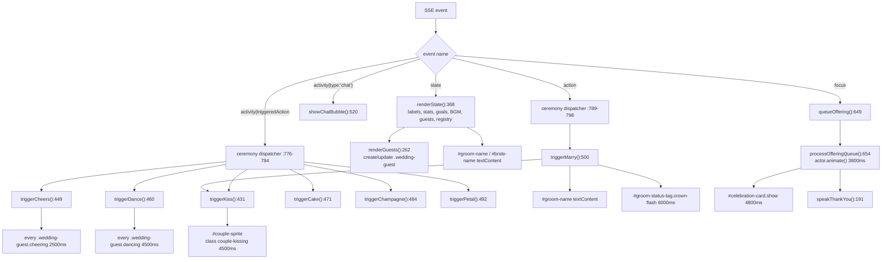
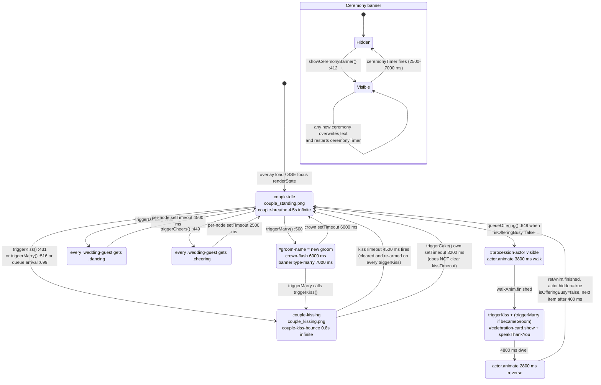
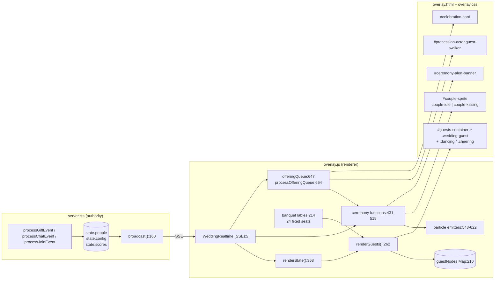

# 06 — CHIBI ENGINE

> Terminology note: the project never uses the word "Chibi", "sprite sheet" or "engine". What exists is a **CSS-driven character system**: fixed-position DOM nodes whose `background-image` is swapped and whose keyframe animation class changes. This document describes that system as implemented, and explicitly records what a "Chibi engine" would normally provide but does not exist here.

## 6.1 Character inventory

| Character | Identity | Assets | Node | Controller |
|---|---|---|---|---|
| Bride + Groom (a single composed image pair, not two independently controlled characters) | `config.bride`, `config.groom` | `couple_standing.png` (idle), `couple_kissing.png` (kiss) | `#couple-sprite` inside `#couple-wrapper` (`overlay.html:34`) | `triggerKiss`, `triggerMarry`, `renderState` |
| Guests (crowd) | `state.people[]` (`id`, `name`, `avatar`, `sprite`, `table`, `seat`, `statusTag`) | `guest_1..6.png` | `.wedding-guest` created by `renderGuests` inside `#guests-container` | `renderGuests`, `triggerDance`, `triggerCheers`, `showChatBubble` |
| Red-carpet donor (procession actor) | the giver of the current `focus` event | hard-coded `guest_2.png` (`overlay.js:682`) | `#procession-actor` (`overlay.html:60`) | `queueOffering`, `processOfferingQueue` |

**The bride and groom are not separable.** There is exactly one `<div id="couple-sprite">` (`overlay.html:34`) whose background image is one of two composited PNGs. There is no independent bride sprite, groom sprite, or per-character position. The groom's *name* changes (`#groom-name`, `overlay.js:368-371`, `:505`) but the pixels never do. So "bride and groom management" is limited to: two text labels, a crown badge, and two images.

## 6.2 Character loading and configuration

| Concern | Verified implementation |
|---|---|
| Loading | CSS `background-image` declared in `overlay.css:322-331`; both couple PNGs are also `<link rel="preload">` in `overlay.html:7-8` |
| Identification | `state.people[].id` — seeded as `guest-1..guest-24`, TikTok viewers become `tik-<userId>` (`server.cjs:177`, `:200`, `:242`) |
| Positioning | Fixed coordinate table, 24 entries, `banquetTables` (`overlay.js:214-248`), each `{x, y, scale}`; node placed at `left = seat.x - 67`, `top = seat.y - 145`, `transform: scale(seat.scale)`, `zIndex = round(seat.y/10)` (`:311-317`) |
| Scaling | per-seat `scale` 0.58 → 0.88 (perspective rows); whole scene additionally scaled by `fit()` to any viewport (`:27-42`); couple fixed at 255×280 px (`overlay.css:312`) |
| Visibility | everyone is always visible; no hide/show API; only `guestNodes` removal when an id disappears from `people` (`:270-275`) — which never happens because the server never removes people |
| Multiple characters | unbounded — every unique TikTok id is pushed into `state.people` (`server.cjs:277`) |
| Configuration | `config.groom`, `config.bride`, `config.title` only; **no** per-character config (no size, colour, sprite choice, voice, or position override) |

### Seat-assignment defect (verified)

Server assigns new viewers:

```js
const seatIdx = state.people.length;
table: Math.floor(seatIdx / 2) % 6,   // server.cjs:189, :216, :276
seat:  seatIdx % 2
```

Overlay then does:

```js
const seatIdx = (p.table !== undefined ? p.table : index) % banquetTables.length;  // overlay.js:310
```

Because `table` is always in `0..5`, **only `banquetTables[0..5]` (the 6 back-left seats) are ever used for TikTok guests.** The 18 remaining seats are reachable only by the 24 seeded `defaultState.people`, whose `table` values run `0..23`. New viewers therefore stack on top of the 6 leftmost seeded guests. Additional detail: `p.seat` is stored but never read by the overlay.

## 6.3 Animation system

Animations are **CSS keyframes toggled by class**, plus **Web Animations API** for the one positional walk.

| Animation | Trigger | Mechanism | Duration | Code |
|---|---|---|---|---|
| Idle breathing (couple) | default class `couple-idle` | `@keyframes couple-breathe` | 4.5 s infinite | `overlay.css:322-325`, `:333-336` |
| Kiss bounce | `couple-kissing` class + image swap | `@keyframes couple-kiss-bounce` | 0.8 s alternate infinite | `overlay.css:327-331`, `:338-341` |
| Crown float | always on `#groom-status-tag` | `crown-float` | 2 s alternate infinite | `overlay.css:107-114` |
| Crown victory flash | `crown-flash` class for 6 s | `crown-victory` | 0.5 s alternate infinite | `overlay.css:96-105`; `overlay.js:508-512` |
| Guest idle sway | always on `.wedding-guest` | `guest-idle-sway` with `--delay` | 3.6 s alternate | `overlay.css:352-363`; delay set at `overlay.js:281` |
| Guest dance | `.dancing` for 4.5 s | `guest-dance` on `.guest-sprite` | 0.38 s alternate | `overlay.css:375-385`; `overlay.js:460-469` |
| Guest cheer | `.cheering` for 2.5 s | `guest-cheer` ×3 | 0.55 s | `overlay.css:388-398`; `overlay.js:449-459` |
| Walk to altar / back | `.walking` + `actor.animate([...])` | WAAPI keyframes with 4/3 waypoints | 3.8 s / 2.8 s, `ease-in-out`, `fill:'forwards'` | `overlay.js:693-712`, `:735-744` |
| Ceremony banner pop | banner unhidden | `ceremony-pop` | 0.6 s | `overlay.css:195-200` |
| Toast glow | `showToast` | `toast-glow` | 3 s alternate | `overlay.css` toast block; `overlay.js:534-546` |
| Falling petals / bubbles / hearts | particle spawners | `rose-fall`, `bubble-float`, `heart-float` | 4-12 s | `overlay.js:548-622` |

| State-management question | Answer |
|---|---|
| Where is animation state stored? | In the DOM (class lists and element presence) plus module-level timer handles: `ceremonyTimer`, `kissTimeout`, `isOfferingBusy`, `offeringQueue` (`overlay.js:411`, `:430`, `:646-647`) |
| Transitions | CSS `transition` on `#couple-sprite` (`transform 0.3s, filter 0.3s`, `overlay.css:319`) |
| Animation queueing | Only the red-carpet procession is queued. Ceremonies are not. |
| Interruption | A new ceremony overwrites the shared banner; sprite classes are toggled without ownership tracking (see `05_EVENT_PROCESSING_ENGINE.md` §5.4) |
| Synchronisation | None between server and client: durations are hard-coded client-side; the server never knows a ceremony is running |
| Concurrent behaviour | Overlapping ceremonies all mutate the same handful of nodes; latest write wins for text, additive for classes |

## 6.4 Event → character mapping



### 6.4.1 Animation lifecycle (couple sprite — the only explicit state machine)



Note: the diagram is the *couple* lifecycle only. Guest `dancing`/`cheering` and the procession are included because they drive the same nodes; there is no state machine for individual guests, and no server-side knowledge of any of these states.

## 6.5 Asset management

| Asset type | Present? | How loaded |
|---|---|---|
| Character stills (PNG) | **Yes**, 8 files | CSS `background-image` (couple, `overlay.css:322-331`) and JS `url('${guestSprites[i]}')` (`overlay.js:288`, `:281`) |
| Sprite sheets / atlases | **No** | no `background-position` animation, no sheet slicing anywhere |
| GIF animations | **No** | none in `assets/` |
| Video | **No** | none |
| Audio files | **No** — `public/audio/` is empty | all SFX are synthesised: `playClink` `:136`, `playWeddingBell` `:154`, `playFanfare` `:172` |
| Voice | **No files** | `speechSynthesis` with a chosen Vietnamese voice (`:191-207`) |
| Music | **No file** | YouTube IFrame `YT.Player` with `videoId` from `config.bgm` (`:47-85`) |
| Effects | CSS/DOM only | petals, bubbles, hearts (`:548-622`); `#fireworks-layer` exists in markup but **nothing ever writes to it** |
| Background | 1 JPG | `` + 2 CSS glow layers (`overlay.html:21-25`) |

## 6.6 Chibi engine architecture diagram



## 6.7 What is *not* a Chibi engine

Recorded so the gap is unambiguous: no per-character state machine, no animation graph or blending, no sprite atlas, no physics, no character-level event bus, no interpolation between poses, no save/restore of a character's animation state, no client-side authority over who is on stage. The "engine" is a coordinate table plus ~15 CSS keyframe rules plus three module-level timers.
