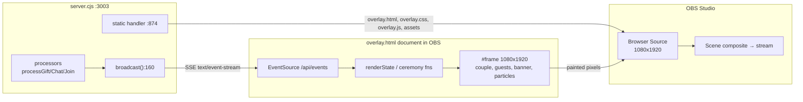

# 08 — OBS OVERLAY SYSTEM

## 8.1 Overlay surfaces

| Page | URL | Purpose | Fixed size |
|---|---|---|---|
| LIVE overlay | `http://localhost:3003/overlay.html` | the scene captured by OBS / TikTok LIVE Studio | `#frame` = **1080 × 1920** (`overlay.css:18-28`) |
| Dashboard | `http://localhost:3003/` | operator console; embeds the overlay in a phone-frame iframe (`index.html:448-455`) at a scaled size | fluid (`panel.css`) |

There is **one** overlay page. It is not parametrised: no query string, no theme switch, no `?scene=` variants. The dashboard's "copy LIVE link" button copies exactly `origin + '/overlay.html'` (`panel.js:27-34`) and the launcher banner prints the same URL (`launcher.cjs:64`).

## 8.2 Canvas and scaling

```js
const s = Math.min(innerWidth / 1080, innerHeight / 1920);   // overlay.js:28
frame.style.transform = `scale(${s})`;
frame.style.left = `${(innerWidth - 1080 * s) / 2}px`;
frame.style.top  = `${(innerHeight - 1920 * s) / 2}px`;
```

`fit()` runs at module load, on `resize`, on `load`, and via a `ResizeObserver` on `document.documentElement` (`overlay.js:27-42`). The scene is therefore **letterboxed to fit any viewport while always laying out against a 1080×1920 grid**. Recommended OBS Browser Source size: **1080 × 1920** (portrait). Any other size works but scales the whole composition.

Rendering engine: the browser's own compositor — CSS gradients, `mix-blend-mode: screen` glows, CSS keyframes, and WAAPI. No canvas, no WebGL, no `<video>`.

## 8.3 Browser Source compatibility

| Requirement | Status |
|---|---|
| Plain HTTP URL, no auth | ✅ `http://localhost:3003/overlay.html` |
| No user gesture needed for visuals | ✅ SSE auto-connects; ceremonies are CSS class changes |
| No user gesture needed for audio | ❌ **not satisfiable by design** — the overlay relies on `pointerdown`/`keydown` one-shot listeners to unlock audio (`overlay.js:118-121`, `:128-130`) and YouTube autoplay. An OBS Browser Source cannot click, so in OBS: **BGM (YouTube) and WebAudio SFX and speech may stay silent** unless OBS's own "Control audio via OBS" / autoplay flags or a local interaction allow it. This is an inherent limitation of the implementation, not a bug in OBS. |
| Transparent background | ❌ `body`/`#frame` paint `#0d0705` / `#140906` (`overlay.css:12`, `:23`) — the overlay is **opaque**, intended to cover the whole frame |
| Persistence across refresh | ✅ initial `state` snapshot restores names, stats, goals, guests, registry, BGM config; **❌ in-flight ceremonies, the red-carpet queue and the current crown flash are lost** |
| Multiple simultaneous overlays | ✅ technically (each opens its own SSE stream and gets all broadcasts) but each maintains its **independent** queue and animation state, so two overlays can show different ceremonies for the same gift |

### Where the overlay gets the page from

The server static handler (`server.cjs:874-895`) resolves `path.join(__dirname,'public', pathname)`, rejects anything whose resolved path does not start with `public`, sets `Content-Type` from a fixed MIME map (`:605-618`), and caches images/fonts/audio for 1 h while serving HTML/CSS/JS with `no-cache`. There is no gzip, no range support, and no SPA fallback (unknown paths → 404 text).

## 8.4 Real-time synchronisation

| Direction | Transport | Payload |
|---|---|---|
| server → overlay | SSE `/api/events` | `state` (whole document), `bgm`, `activity`, `action`, `focus` |
| overlay → server | **none** | the overlay never sends anything back |
| overlay ↔ OBS | none | OBS captures pixels; no IPC, no browser-source API |

Handlers in `overlay.js`:

| SSE event | Handler | Effect |
|---|---|---|
| `state` | `:758-764` → `renderState` | labels, stats, goals, BGM, guests, registry |
| `bgm` | `:765-771` → `updateBgmState` | swap/pause/volume YouTube player, update badge title |
| `activity` (chat) | `:772-785` | chat bubble over the guest + optional ceremony from `triggeredAction` |
| `action` | `:787-798` | ceremony dispatcher (`marry`, `kiss`, `cheers`, `dance`, `cake`, `champagne`, `petal`) |
| `focus` | `:800-804` | enqueue red-carpet procession |

Initial snapshot: the server writes `state` and `status` immediately on connect (`server.cjs:651-652`). The overlay has **no** `status` listener, so TikFinity connection health is invisible on the LIVE screen.

### Connection resilience (overlay side)

`WeddingRealtime.connect()` creates `new EventSource('/api/events')` and, in `onerror`, calls `connect()` again after 3 s **without closing the previous EventSource** (`overlay.js:10-15`). Browsers already auto-reconnect an EventSource, so a flaky stream can accumulate duplicate sources and duplicate handler invocations. `addEventListener` attaches directly to the current `es`, so handlers registered before a reconnect are lost on the new instance — the ceremony dispatcher registered at `:758-805` runs on the initial instance only.

## 8.5 Data flow to OBS



## 8.6 Refresh behaviour

| Scenario | Result |
|---|---|
| OBS refreshes the source | full reload; `fit()` runs; SSE reconnects; `state` snapshot restores counters/guests/registry; any ceremony in progress disappears; the offering queue is emptied; the YouTube player is re-created (may need re-unlock) |
| Dashboard "Làm mới màn hình" | sets `iframe.src = '/overlay.html?v=' + Date.now()` (`panel.js:44-48`) — a cache-busting reload of the preview only |
| Server restart | all SSE clients drop, state is re-read from `wedding_state.json`, overlay reconnects and re-renders; `config.groom` persists exactly as the last auction left it |
| `POST /api/reset` | server broadcasts `state` with empty `people`/`scores`/`recentGivers` and zeroed stats — overlay removes guest nodes (`:270-275`) and shows "Chờ phong bì đầu tiên…" in the registry |

## 8.7 Known overlay-side gaps

1. `#fireworks-layer` exists in markup (`overlay.html:78`) but no code path appends to it; `showFireworks` in config is never read.
2. `overlay.css:1` imports `/fonts/typography.css`, which **does not exist** → 404 on every load; the intended `'An Nhien Sans'` family never applies, yet `fonts/noto-sans-vietnamese.ttf` is shipped unused.
3. Audio unlock depends on a pointer/key event that OBS never produces (see §8.3).
4. No `status` rendering — the operator cannot tell from the LIVE screen whether TikFinity is connected.
5. No error surface: if `/api/events` never connects, the overlay shows a plausible but static wedding scene with seed data, which looks like "working" during a broken live.
