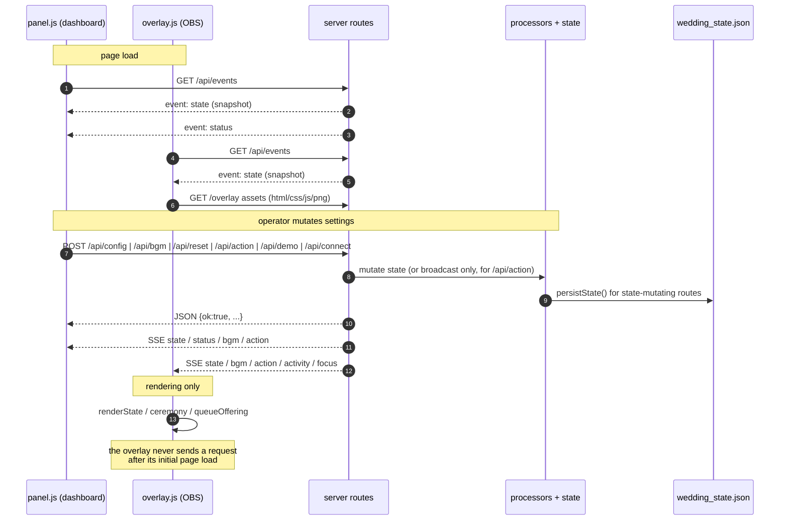

# 11 — API AND INTERNAL COMMUNICATION

Base URL: `http://localhost:3003` (or `TIECCUOI_PORT`). Server binds `0.0.0.0` (`server.cjs:897`). Every response, including errors, carries `Access-Control-Allow-Origin: *`, `Allow-Methods: GET, POST, OPTIONS`, `Allow-Headers: Content-Type` (`server.cjs:621-625`); `OPTIONS` is answered `204` (`:627-631`).

**Authentication: none on any endpoint.** No token, cookie, header check, origin check or rate limit exists anywhere in `server.cjs`.

## 11.1 Endpoint table

| # | Method | Endpoint | Handler (line) | Input | Output | Purpose |
|---|---|---|---|---|---|---|
| 1 | GET | `/api/events` | `server.cjs:646-658` | — | `text/event-stream`; immediate `state` + `status`, then deltas | all realtime sync |
| 2 | GET | `/api/license/status` | `:660-670` | — | `{valid:true, plan:'pro', status:'active', licenseKey, expiresAt:'2099-12-31'}` (hard-coded) | liveness probe + decoy licence |
| 3 | GET | `/api/state` | `:673-678` | — | full `state` JSON | snapshot for tooling; **not used by either front end** |
| 4 | POST | `/api/config` | `:680-693` | JSON object intended as config fields; `bgm` deep-merged | `{ok:true, config}` | change settings (see path defect) |
| 5 | POST | `/api/action` | `:695-702` | `{action, …}` arbitrary | `{ok:true, action}` | fire a ceremony on overlays; **no state change, no validation** |
| 6 | POST | `/api/bgm` | `:704-731` | `{youtubeUrl?, title?, volume?, playing?, enabled?}` | `{ok:true, bgm}` | update YouTube BGM; parses 11-char video id, clamps volume 0-100 |
| 7 | POST | `/api/demo` | `:733-766` | `{type:'chat'\|'gift', …}` | chat: `{ok, chat}`; gift: `{ok, offeringEvent, becameGroom}`; else `400 {error:'Unknown demo type'}` | simulator |
| 8 | POST | `/api/connect` | `:768-781` | `{mode:'tikfinity'}` (ignored) | 200 `{ok:true,status}` or 400 `{ok:false,error,status}` | open the TikFinity WebSocket |
| 9 | POST | `/api/disconnect` | `:783-789` | — | `{ok:true,status}` | close it and mark offline |
| 10 | GET | `/api/status` | `:791-796` | — | `state.status` | TikFinity status; **not used by the front end** (it uses SSE) |
| 11 | POST | `/api/tikfinity` | `:798-827` | flat webhook object (`event`, `uniqueId`, `nickname`, `comment`, `giftName`, `repeatCount`, `diamondCount`, `profilePictureUrl`, …) | always `{ok:true}` | webhook fallback into the processors |
| 12 | POST | `/api/reset` | `:829-844` | — | `{ok:true,state}` | clear session data |
| 13 | POST | `/api/speech` | `:846-872` | `{text}` (1-300 chars) | `audio/mpeg` stream or `500 {error}` | Google Translate TTS proxy — **never called by either front end** |
| 14 | GET | *any path* | `:874-895` | — | static file from `public/` | overlay, dashboard, assets |

Unknown `/api/*` paths fall through to the static handler and return `404 text/plain` (not JSON). `/` maps to `index.html` (`:874`).

### Frontend ↔ backend communication paths



## 11.2 Endpoint detail

### 1. `GET /api/events` (SSE)

Headers: `Content-Type: text/event-stream`, `Cache-Control: no-cache`, `Connection: keep-alive`. On connect the server writes:

```
event: state\ndata: <full state JSON>\n\n
event: status\ndata: <state.status JSON>\n\n
```

then registers the response in `clients` and removes it on `req.close`. There is no heartbeat comment frame, no `retry:` hint, no `Last-Event-ID` support, and no cap on concurrent clients.

### 4. `POST /api/config` — mismatch warning

```js
const data = await readJson();
state.config = { ...state.config, ...data, bgm: {...state.config.bgm, ...(data.bgm||{})} };
```

Only **flat** config keys work. The dashboard sends `{config:{…}}` and `{goals:{…}}`, producing `state.config.config` and `state.config.goals` (verified present in `wedding_state.json`) instead of the intended changes. A direct caller posting `{"groom":"An","bride":"Bình","minCoinsToMarry":20}` **does** work.

### 5. `POST /api/action` — accepted verbs

The route broadcasts whatever it receives. The overlay honours exactly: `marry` (falls back to `d.initiator || d.newGroom`), `kiss`, `cheers`, `dance`, `cake`, `champagne`, `petal` (`overlay.js:789-798`). Any other verb - including the dashboard's `steal_groom` - is broadcast and silently ignored by all clients. Body: any JSON; no schema, no length limit, no allowlist.

### 6. `POST /api/bgm`

`youtubeUrl` is matched against `/^.*(youtu.be\/|v\/|u\/\w\/|embed\/|watch\?v=|\&v=)([^#\&\?]*).*/` and accepted only when the captured id is exactly 11 chars; otherwise `youtubeId` becomes `''`. `volume` clamped to `0..100` (default 50). Broadcasts both `state` and `bgm`.

### 7. `POST /api/demo`

`type:'chat'` builds `{id,name,comment,avatar}` with defaults and calls `processChatEvent`. `type:'gift'` builds `{id,name,gift,count,diamonds,avatar}` and calls `processGiftEvent`, echoing `offeringEvent` and `becameGroom`. **`type:'comment'` (what `panel.js` sends) is not accepted** → `400`.

### 11. `POST /api/tikfinity` (webhook)

Branch order: `event==='chat' || body.comment` → chat; else `event==='gift' || giftId || giftName` → gift; else `event==='member' || 'join'` → join; else **no-op 200**. Note the loose truthiness: any body containing a `comment` field is treated as chat regardless of `event`, and any body with `giftName` is a gift even without `event:'gift'`.

### 13. `POST /api/speech`

Rejects `text` shorter than 1 or longer than 300 chars with `400 {error:'Text length must be 1-300 chars'}`. Otherwise performs `https.get('https://translate.google.com/translate_tts?ie=UTF-8&q=…&tl=vi&client=tw-ob')` and pipes `audio/mpeg` with `Cache-Control: public, max-age=86400`; non-200 upstream → `500 {error:'Google TTS failed'}`; network error → `500 {message}`. Unauthenticated outbound proxy.

### 14. Static handler

`path.join(__dirname,'public', pathname==='/'?'index.html':pathname)`; any resolved path not prefixed by `…\public` → `403 Forbidden`. Missing file → `404 text/plain`. MIME from a 12-entry map; images/fonts/audio cached `max-age=3600`, everything else `no-cache`. No gzip, no etag, no directory index, no listing.

## 11.3 SSE event catalogue (all six)

| Event | Emitted at | Payload |
|---|---|---|
| `state` | `:656` (initial), `:193`, `:236`, `:349`, `:689`, `:727`, `:843` | the entire `state` object |
| `status` | `:549`, `:567`, `:657` (initial), `:659` region, `:775`, `:781` | `{state, message, username?, roomId?, mode}` |
| `bgm` | `:728` | `config.bgm` |
| `action` | `:233` (chat keyword), `:335` (marry), `:342`/`:344`/`:346` (gift regex), `:697` (manual) | `{action, initiator?, previousGroom?, text?}` |
| `activity` | `:194` (join), `:230` (chat) | `{type:'join'\|'chat', id, name, avatar?, comment?, triggeredAction?}` |
| `focus` | `:333` | `{id, name, gift, count, diamonds, total, avatar, prayer, becameGroom, previousGroom, isRobbed, funnyMessage}` |

`triggeredAction` values produced by keyword matching (`server.cjs:224-229`): `kiss`, `cheers`, `dance`, `cake`, `champagne`, `petal` (first match wins, priority order as listed).

## 11.4 Internal message formats and contracts

| Contract | Producer | Consumer | Shape | Enforced? |
|---|---|---|---|---|
| TikFinity frame | external | `handleMessage` | `{event:string, data:object}` | only by optional chaining and `catch` |
| normalised user | `parseUser` | processors | `{id,name,avatar}` | no |
| normalised gift | `parseGift` | `processGiftEvent` | `{id,name,avatar,gift,giftId,count,diamonds}` | no |
| focus ceremony | `processGiftEvent` | `queueOffering` | fields listed above | no |
| action verb | server / dashboard | overlay dispatcher | `{action:string,...}` | **no** (hence `steal_groom` no-op) |
| config write | dashboard | `/api/config` | intended flat; actual `{config:{}}`/`{goals:{}}` | **no** (hence defects) |
| state document | `state` | both front ends | 7 top-level keys | no schema/version |

## 11.5 Error responses

| Status | Where | Body |
|---|---|---|
| 204 | `OPTIONS` | empty |
| 400 | `/api/demo` unknown type | `{error:'Unknown demo type'}` |
| 400 | `/api/speech` length | `{error:'Text length must be 1-300 chars'}` |
| 400 | `/api/connect` failure | `{ok:false, error:<message>, status}` |
| 403 | static traversal guard | `Forbidden` (text) |
| 404 | unknown static path | `404 Not Found` (text) |
| 500 | `/api/speech` | `{error:'Google TTS failed'}` or `{error:<message>}` |

No route validates `Content-Type`, no route limits body size (`readJson` accumulates until `end`, `server.cjs:636-644`), and a thrown exception inside an `async` route handler other than `/api/connect` produces an unhandled rejection with **no response at all**.
