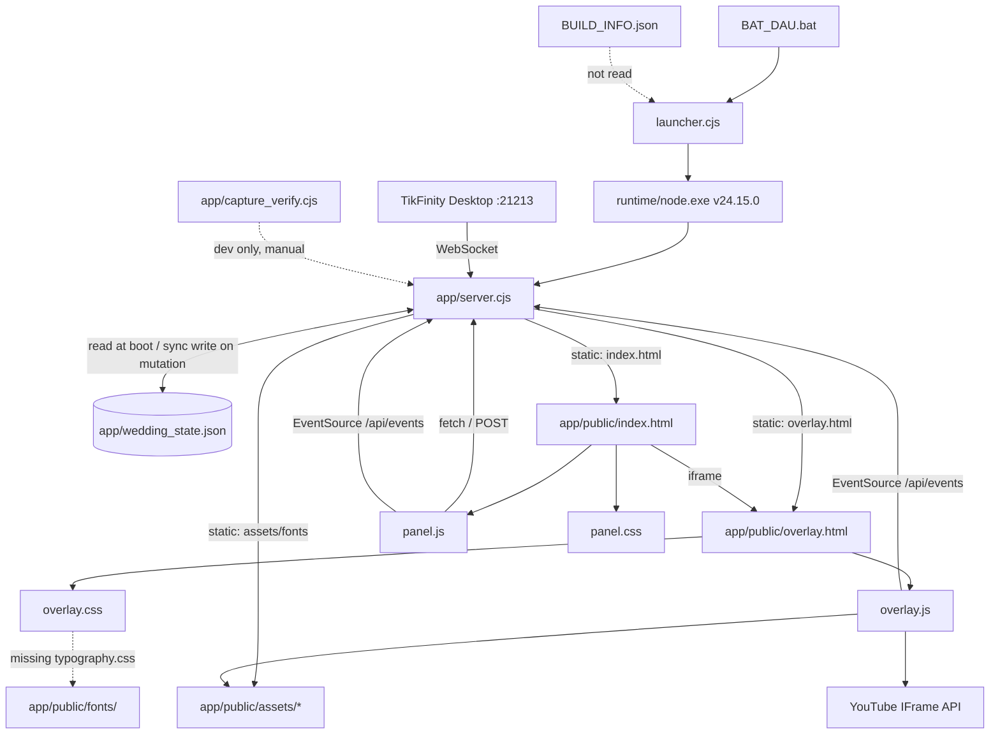

# FILE REFERENCE INDEX

Every source file in the project, its purpose, and its relationships. Binary assets are listed with type/size but not parsed. Paths are relative to the project root.

Legend: **R** = reads, **W** = writes, **S** = serves, **L** = loaded by, **C** = calls/consumes.

---

## 1. Root

### `BAT_DAU.bat` — 11 lines
Windows entry point. `chcp 65001`, `cd /d "%~dp0"`, title, aborts if `runtime\node.exe` is missing (`:5`), else runs `runtime\node.exe launcher.cjs` (`:9`), `pause` on non-zero exit.
- **L/C:** `runtime/node.exe`, `launcher.cjs`.
- **Called by:** the user.

### `BUILD_INFO.json` — 11 lines
Metadata: `product: "TiecCuoiLive"`, `name`, `version 1.0.0`, `author`, `contact`, `buildId: "tc-20261103-v1"`, `port: 3003`.
- **R by:** nothing (verified).
- **Note:** its `product` value is exactly what `launcher.cjs:27/:59` expects from the API and never receives.

### `launcher.cjs` — 72 lines
Process supervisor. `openBrowser()` (`:9-14`) via `rundll32`; `check()` (`:16-23`) 700 ms probe of `/api/license/status`; IIFE (`:25-72`) resolves the port (`:6`), detects existing/foreign listeners (`:27`, `:32`), spawns `runtime/node.exe app/server.cjs` with `cwd=app`/`env.PORT`/`stdio:'inherit'` (`:39-49`), forwards `SIGINT` (`:56`), polls 80×250 ms (`:57-70`).
- **R:** `node:fs` (unused import), `node:path`, `node:child_process`, global `fetch`.
- **C:** `app/server.cjs` via spawn; `runtime/node.exe`.
- **Called by:** `BAT_DAU.bat`.
- **Known defect:** identity probe can never match (audit F-01).

### `runtime/node.exe` — 91.7 MB binary
Portable Node.js **v24.15.0** (verified by execution). Provides the global `WebSocket` used at `server.cjs:406`.
- **Called by:** `BAT_DAU.bat`, `launcher.cjs`.

---

## 2. Backend — `app/`

### `app/server.cjs` — 899 lines — **the entire backend**
Single CommonJS module using `node:http`, `node:fs`, `node:path`, `node:https`, `node:events`.

| Region | Lines | Responsibility |
|---|---|---|
| constants | 1-8 | `PORT` (env, 3003), `STATE_FILE` |
| `defaultState` | 11-126 | seed config (identities, toggles, `giftSlots`, joke/wish/template arrays, `bgm`), stats, goals, 24 seeded people, 5 scores, recentGivers, status |
| boot merge | 128-148 | **R** `wedding_state.json`, per-key merge over defaults |
| `persistState()` | 150-156 | **W** `wedding_state.json` (sync, whole document) |
| `clients`, `broadcast()` | 159-170 | SSE fan-out |
| `processJoinEvent` | 175-196 | roster + `stats.guests`, emits `activity`/`state` |
| `processChatEvent` | 198-238 | roster + `stats.wishes` + keyword→action, emits `activity`/`action`/`state` |
| `processGiftEvent` | 240-353 | counters, goals, scores, roster, registry, **marriage auction**, emits `focus`/`action`/`state`, returns the focus payload |
| `class TikFinityClient` | 357-534 | WebSocket client: `status`, `roomInfo`, `connect`, `handleMessage`, `parseUser`, `parseGift`, `disconnect` |
| connection orchestration | 536-603 | `activeTikFinityClient`, `tikfinityReconnectTimer`, `userDisconnected`, `connectTikFinity`, `disconnectTikFinity` |
| `MIME` | 605-618 | 12 extension→type entries |
| request handler | 620-895 | CORS, `readJson`, 13 API routes, static server |
| listen | 897-899 | `0.0.0.0:PORT` |

- **R:** `wedding_state.json`, `public/**` (via `createReadStream`).
- **W:** `wedding_state.json`.
- **Outbound:** `ws://127.0.0.1:21213/` (TikFinity), `https://translate.google.com/translate_tts` (only `/api/speech`).
- **Called by:** `launcher.cjs`.
- **Consumed by:** `panel.js` (`/api/*`), `overlay.js` (`/api/events`), OBS (static).

### `app/capture_verify.cjs` — 250 lines — developer harness (not in the flow)
Headless Edge (`--remote-debugging-port=9222`) + minimal CDP WebSocket client; captures 1080×1920 overlay shots (default, petal, cake) and a 1440×900 dashboard shot; POSTs `/api/action`. Hard-codes `C:\Users\ducqu\.gemini\antigravity\brain\<uuid>` and the Edge path; writes outside the project.
- **R:** `node:child_process`, `node:http`, `node:fs`, `node:path`, `node:crypto`, `node:os`; Edge binary.
- **C:** `http://localhost:3003/overlay.html`, `/`, `/api/action`.
- **Called by:** nothing.

### `app/wedding_state.json` — ~160 lines — the only persistent store
Keys: `config` (incl. nested `bgm`, `giftSlots`, `funnyJokes`, `marryJokes`, `wishes`, and a stray nested `config.config` proving the `/api/config` payload defect), `stats`, `goals`, `people[]`, `scores{}`, `recentGivers[]`, `status{}`.
- **R/W by:** `server.cjs` only.
- **Note:** tracked by git and mutated at runtime; already dirty before this analysis.

---

## 3. Frontend — `app/public/`

### `index.html` — 518 lines — dashboard
Three-column shell; 7 `.nav-item[data-tab]` buttons; sections `#tab-overview`, `#tab-couple`, `#tab-registry`, `#tab-goals`, `#tab-voice`, `#tab-bgm`, `#tab-tikfinity`; TikFinity connect card (`#connect`, `#disconnect`, `#status`, `#notice-dot`, `#connection-message`); 4 stat cards; 7 ceremony buttons (`#btn-action-*`); comment simulator (`#sim-comment-input`, `.tag-btn`, `#btn-send-sim-comment`); 4 gift simulators (`.btn-gift[data-gift|data-count|data-coins]`); registry table `#table-registry`; voice/BGM forms; inline `onclick` at `:397`/`:411`; preview `iframe#preview-iframe`.
- **L:** `panel.css`, `panel.js`, `/overlay.html`.
- **S by:** `server.cjs` static handler at `/`.
- **C:** every `/api/*` endpoint via `panel.js`.

### `panel.js` — 412 lines — dashboard behaviour
`updateClock` (:5), tab switching (:14-23), copy link/webhook/refresh (:26-48), `sendAction` (:50-60) + 7 buttons (:62-68), comment sim (:71-90), gift sim (:92-108), `#btn-save-couple` (:111), `#btn-save-goals` (:129), `#btn-save-voice` (:147), `#btn-test-voice` (:164), reset (:189), `saveBgm` (:196-220) + BGM controls (:222-252), `renderAdminState` (:254-318), `EventSource('/api/events')` (:320-335), `updateConnectionStatus` (:337-384), `#connect` (:386-405), `#disconnect` (:407-411).
- **C:** `/api/config`, `/api/action`, `/api/demo`, `/api/bgm`, `/api/reset`, `/api/connect`, `/api/disconnect`, `/api/events` (SSE).
- **L by:** `index.html`.
- **Known defects:** wrong config payload shape (F-02), `type:'comment'` (F-07), `steal_groom` (F-08), `innerHTML` donor names (F-04).

### `panel.css` — 723 lines — dashboard styling
Layout, sidebar, cards, tables, status pills (`offline`/`connecting`/`waiting`/`connected`/`retry`/`error`), buttons, phone-frame preview. Contains rules for a `retry` state the server never emits.

### `overlay.html` — 232 lines — LIVE overlay markup
`#frame` (1080×1920) → `#scene` (`.stage-bg`, glow layers, `#wedding-stage`/`#couple-wrapper` with `#groom-status-tag`, `#ceremony-alert-banner`, `#couple-hearts`, `#couple-sprite`, `#couple-label`, `#stage-fx`), `#guests-container`, `#procession-actor`, `#celebration-card`; particle layers `#petals`, `#bubbles-layer`, `#hearts-layer`, `#fireworks-layer` (unused); `#wedding-header` (title, metrics, 2 goal pills, BGM badge); `.left-widgets` (how-to-play, `#registry-list`); `#gift-guide-panel`; `#live-footer` + `#footer-toast`; hidden `#yt-player-slot`; `<script src="https://www.youtube.com/iframe_api">` at `:13`; `<script type="module" src="/overlay.js">` at `:216`.
- **L:** `overlay.css`, `overlay.js`, 8 assets, YouTube IFrame API.
- **S by:** `server.cjs` at `/overlay.html`; embedded in the dashboard iframe; loaded by OBS.

### `overlay.js` — 805 lines — overlay engine
`WeddingRealtime` SSE wrapper (:5-24, with unused `handlers`/`dispatch`), `fit()` (:27-42), YouTube BGM (:44-120), WebAudio SFX (:123-188), `speakThankYou` (:191-207), `currentState`/`guestNodes` (:209-210), `banquetTables` 24 seats (:214-248), `guestSprites` (:250-257), `renderGuests` (:262-325), `renderRegistry` (:327-366), `renderState` (:368-409), `showCeremonyBanner` (:412-428), `triggerKiss` (:431), `triggerCheers` (:449), `triggerDance` (:460), `triggerCake` (:471), `triggerChampagne` (:484), `triggerPetal` (:492), `triggerMarry` (:500), `showChatBubble` (:520), `showToast` (:534), particles (:548-622), ambient chatter (:637-644), offering queue (:646-754), SSE subscriptions (:756-805).
- **C:** `/api/events` (SSE), `/assets/*`, `YT` global, `speechSynthesis`, WebAudio.
- **L by:** `overlay.html`.
- **Known defects:** duplicate EventSource (F-10), duplicate ceremony paths (F-14), seat collision (F-09), unhandled animation rejections (F-19).

### `overlay.css` — 1066 lines — overlay styling and all keyframe animation
`@import '/fonts/typography.css'` (**missing file**, `:1`); `#frame` 1080×1920 (`:18-28`); stage/glow layers; couple sprite states (`:312-341`); crown (`:96-114`); ceremony banner + type variants (`:180-252`); guest sprites, `dancing`/`cheering`, name badges, chat bubbles; procession actor; celebration card; header/metrics/goals; widgets; gift guide; footer/toast; particle keyframes.
- **L by:** `overlay.html`; **references** `/assets/couple_standing.png`, `/assets/couple_kissing.png`.

---

## 4. Assets — `app/public/assets/`

| File | Size | Role | Referenced by |
|---|---|---|---|
| `wedding_stage_bg.jpg` | 1.13 MB | hall background | `overlay.html:21` |
| `couple_standing.png` | 680 KB | bride+groom idle (one composited image) | `overlay.css:323` |
| `couple_kissing.png` | 573 KB | bride+groom kiss | `overlay.css:328` |
| `guest_1.png` … `guest_6.png` | 121-177 KB | 6 guest variants | `overlay.js:250-257`; preloaded in `overlay.html:9-14` |

No sprite sheets, GIFs, videos, or audio files exist. `app/public/audio/` is empty.

## 5. Fonts — `app/public/fonts/`

| File | Size | Role |
|---|---|---|
| `noto-sans-vietnamese.ttf` | 2.0 MB | **never referenced** (no `@font-face` anywhere) |
| `OFL.txt` | 4.4 KB | font licence text |

`/fonts/typography.css` is imported by `overlay.css:1` but **does not exist**.

---

## 6. Relationship map

---

## 7. Call-graph quick reference

| Symbol | Defined | Called from |
|---|---|---|
| `processJoinEvent` | `server.cjs:175` | `:484` (TikFinity), `:821` (webhook) |
| `processChatEvent` | `server.cjs:198` | `:490`, `:744` (demo), `:800` (webhook) |
| `processGiftEvent` | `server.cjs:240` | `:494`, `:748` (demo), `:809` (webhook) |
| `broadcast` | `server.cjs:160` | 12 sites across processors and routes |
| `persistState` | `server.cjs:150` | `:195`, `:236`, `:308`, `:688`, `:726`, `:843` |
| `connectTikFinity` | `server.cjs:554` | `/api/connect` `:770`; retry `:595` (unreachable) |
| `disconnectTikFinity` | `server.cjs:540` | `/api/disconnect` `:784` |
| `handleMessage` | `server.cjs:456` | ws `message` listener `:434` |
| `renderState` | `overlay.js:368` | SSE `state` `:761` |
| `renderGuests` | `overlay.js:262` | `renderState` `:407` |
| `renderRegistry` | `overlay.js:327` | `renderState` `:408` |
| `triggerKiss` | `overlay.js:431` | `activity` `:777`, `action` `:790`, `triggerMarry` `:516`, queue `:699` |
| `triggerMarry` | `overlay.js:500` | `action:'marry'` `:789`, queue `:701` |
| `queueOffering` | `overlay.js:649` | SSE `focus` `:803` |
| `processOfferingQueue` | `overlay.js:654` | `queueOffering` `:651`, self `:752` |
| `showToast` | `overlay.js:534` | every ceremony and the queue |
| `renderAdminState` | `panel.js:254` | SSE `state` `:324` |
| `updateConnectionStatus` | `panel.js:337` | SSE `state` `:326`, SSE `status` `:332`, connect/disconnect handlers |
| `saveBgm` | `panel.js:196` | 4 BGM listeners `:223-251` |

---

## 8. Files that do not exist (checked, to prevent false references)

`package.json`, `package-lock.json`, `node_modules/`, `.env`, any `*.test.*`, `tsconfig.json`, `Dockerfile`, `.gitignore` at root (only `.freebuff/.gitignore`), `app/public/fonts/typography.css`, `app/public/favicon.ico`, any audio file, any sprite sheet, any second overlay page, any database file.
